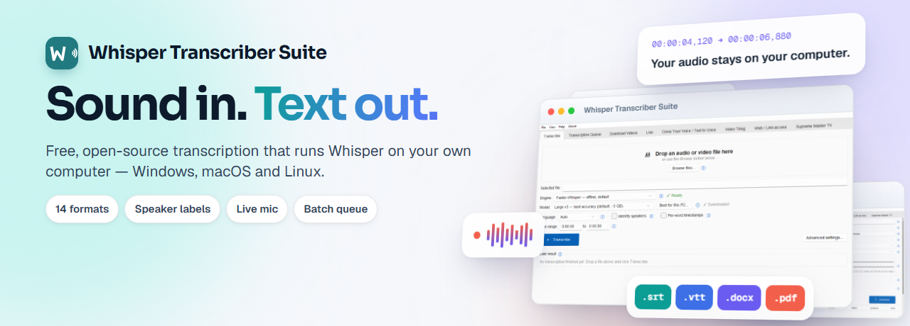

<div align="center">



# Whisper Transcriber Suite

**Bezplatný, offline přepis a titulky pro dlouhé nahrávky ve vašem jazyce — na běžném notebooku, bez účtu a bez nahrávání zvuku na internet.**

[](https://github.com/Milomilo777/whisper-transcriber-suite/actions/workflows/ci.yml)
[](https://github.com/Milomilo777/whisper-transcriber-suite/releases/latest)
[](../../LICENSE)

### [Stáhnout pro Windows](https://github.com/Milomilo777/whisper-transcriber-suite/releases/latest)

macOS a Linux: viz [Stažení](#download).

<!-- language-links:start -->

<p>
<a href="../../README.md">English</a> ·
<a href="README.de.md">Deutsch</a> ·
<a href="README.fr.md">Français</a> ·
<a href="README.es.md">Español</a> ·
<a href="README.it.md">Italiano</a> ·
<a href="README.pt-BR.md">Português (Brasil)</a> ·
<a href="README.pt.md">Português (Portugal)</a> ·
<a href="README.nl.md">Nederlands</a> ·
<a href="README.pl.md">Polski</a> ·
<a href="README.ru.md">Русский</a> ·
<a href="README.uk.md">Українська</a> ·
<a href="README.tr.md">Türkçe</a> ·
<b>Čeština</b> ·
<a href="README.sk.md">Slovenčina</a> ·
<a href="README.hu.md">Magyar</a> ·
<a href="README.ro.md">Română</a> ·
<a href="README.bg.md">Български</a> ·
<a href="README.el.md">Ελληνικά</a> ·
<a href="README.sv.md">Svenska</a> ·
<a href="README.da.md">Dansk</a> ·
<a href="README.nb.md">Norsk bokmål</a> ·
<a href="README.fi.md">Suomi</a> ·
<a href="README.hr.md">Hrvatski</a> ·
<a href="README.sr.md">Српски</a> ·
<a href="README.sl.md">Slovenščina</a> ·
<a href="README.lt.md">Lietuvių</a> ·
<a href="README.zh-CN.md">简体中文</a> ·
<a href="README.zh-TW.md">繁體中文</a> ·
<a href="README.ja.md">日本語</a> ·
<a href="README.ko.md">한국어</a> ·
<a href="README.vi.md">Tiếng Việt</a> ·
<a href="README.th.md">ไทย</a> ·
<a href="README.id.md">Bahasa Indonesia</a> ·
<a href="README.ms.md">Bahasa Melayu</a> ·
<a href="README.hi.md">हिन्दी</a> ·
<a href="README.ar.md">العربية</a> ·
<a href="README.fa.md">فارسی</a> ·
<a href="README.he.md">עברית</a> ·
<a href="README.lv.md">Latviešu</a> ·
<a href="README.ca.md">Català</a> ·
<a href="README.bn.md">বাংলা</a> ·
<a href="README.fil.md">Filipino</a>
</p>

<!-- language-links:end -->
<!-- translated from README.md at commit 66585d5 -->

</div>

## Pro koho to je

Pro tvůrce titulků, překladatele, výzkumníky a novináře, kteří převádějí dlouhé
nahrávky (rozhovory, přednášky, projevy, videa) na text nebo titulky.
Přetáhněte audio nebo video soubor a přepis se zapíše hned vedle něj. Rozpoznávání řeči běží na vašem vlastním počítači, takže se
neplatí žádné poplatky za minutu a po stažení modelu není potřeba
žádné připojení k internetu.

<div align="center">

</div>

## Co je nového ve verzi 2.0

- **Rychlost a zbývající čas:** záložka Queue ukazuje rychlost každé úlohy a odhadovaný zbývající čas.
- **Titulkované video z odkazu:** stáhněte, přepište a vpalte titulky do videa jako jednu úlohu ([docs/SUBTITLED_VIDEO.md](../SUBTITLED_VIDEO.md)).
- **Přepis jako webová stránka:** jeden `.html` soubor s vyhledáváním a přehráváním po kliknutí, který funguje offline v jakémkoli prohlížeči.
- **Offline režim, který si můžete ověřit:** se zapnutou funkcí Work offline ukazuje stavový řádek, zda má aplikace nebo jí spuštěný proces síťové připojení.
- **Překlad do angličtiny:** řeč v jiném jazyce se jedním průchodem převede na anglické titulky.
- **Rychlý start:** nová instalace položí tři otázky a 18sekundová ukázka ihned předvede výsledek.
- **Nahlásit problém** z nabídky Help, bez účtu na GitHubu.
- **macOS:** menu aplikace s Nastavením (Command-čárka), světlý a tmavý režim podle systému, oznámení. **Windows:** průběh na hlavním panelu a tmavé záhlaví oken.

Kompletní seznam: [CHANGELOG](../CHANGELOG.md).

## Funkce

- **Lokální enginy:** [faster-whisper](https://github.com/SYSTRAN/faster-whisper)
  (výchozí), whisper.cpp a NVIDIA Parakeet pro mnoho jazyků, které Whisper
  rozpoznává. Využívá grafickou kartu NVIDIA
  přes CUDA, když je to možné, jinak procesor (CPU).
- **Aplikace ve vašem jazyce:** Nabídky, tlačítka a zprávy ve 42 jazycích (strojově
  přeložené a jako takové označené; opravy jsou vítány). Řídí se jazykem systému,
  nebo si jazyk vyberete v Pokročilém nastavení. Perština, arabština a hebrejština
  jsou zatím k dispozici ve Windows.
- **14 výstupních formátů:** SRT, VTT, ASS, TSV, TXT, JSON, LRC, Markdown, DOCX a
  PDF, plus formáty oTranscribe, ELAN, InqScribe a Express Scribe. DOCX
  a PDF správně vykreslují každé písmo, perština, arabština a urdština se čtou zprava doleva
  se spojenými písmeny.
- **Sdílitelná webová stránka:** uložte hotový přepis jako jeden `.html` soubor, který
  funguje offline v jakémkoli prohlížeči; kliknutím na slovo si ho poslechnete, můžete vyhledávat, přeskakovat po
  kapitolách.
- **Jmenovky mluvčích** bez účtu Hugging Face, navíc časové značky jednotlivých slov a
  oříznutí časového rozsahu.
- **Přerušené úlohy pokračují** od posledního kontrolního bodu, místo aby začínaly
  znovu (výchozí engine).
- **Online videa:** stahování z jakékoli stránky, kterou podporuje [yt-dlp](https://github.com/yt-dlp/yt-dlp),
  a přepis po dokončení stahování.
- **Odkaz na titulkované video:** jedno zaškrtnutí změní odkaz na `<title>-subbed.mp4`
  s vpálenými titulky: stažení, přepis a vpálení titulků v jedné naplánované úloze
  ([docs/SUBTITLED_VIDEO.md](../SUBTITLED_VIDEO.md)).
- **Živě:** přepisujte zvuk z mikrofonu, nebo systémový zvuk ve Windows,
  v reálném čase ([docs/LIVE.md](../LIVE.md)).
- **Dávkové zpracování (Batch queue) a sledovaná složka** pro mnoho souborů najednou.
- **Režim lokální sítě:** stránka pro přepis a API kompatibilní s OpenAI pro
  ostatní zařízení ve vaší síti ([docs/SERVER.md](../SERVER.md)).
- **Volitelné, ve výchozím stavu vypnuté:** AI nástroje pro hotový přepis (shrnutí,
  otázky, dvojjazyčné SRT) a offline převod textu na řeč s klonováním hlasu.

Srovnání se Subtitle Edit, Vibe, Buzz, noScribe a aTrain,
včetně toho, kdy je lepší zvolit jinou aplikaci:
**[docs/COMPARISON.md](../COMPARISON.md)**.

<a id="download"></a>

## Stažení

Nejnovější verze: **[stránka vydání (releases)](https://github.com/Milomilo777/whisper-transcriber-suite/releases/latest)**.

| Soubor | Pro koho |
|---|---|
| `WhisperTranscriberSuite-Installer-Windows-vX.Y.Z.exe` | Windows 10 nebo 11, 64-bit. Tuto verzi bude chtít většina lidí. |
| `WhisperTranscriberSuite-Portable-Windows-vX.Y.Z.zip` | Windows bez instalace: rozbalte a spusťte. |
| `WhisperTranscriberSuite-vX.Y.Z-macOS-arm64.dmg` | Macy s čipem Apple silicon, macOS 14 nebo novější. |
| `WhisperTranscriberSuite-vX.Y.Z-macOS-x64.dmg` | Macy s procesorem Intel, macOS 10.15 nebo novější. |

Na Linuxu se spouští ze zdrojových kódů: [platform/linux/README.md](../../platform/linux/README.md).

Přibalený FFmpeg je sestavení pod licencí GPL. Jeho odpovídající zdrojový kód je připojen ke každému vydání jako
soubory `WhisperTranscriberSuite-vX.Y.Z-source-ffmpeg-*`; přesné odkazy jsou v
[THIRD_PARTY_NOTICES.md](../../THIRD_PARTY_NOTICES.md).

ffmpeg a yt-dlp jsou součástí balení. Při prvním spuštění okno pro rychlý start vybere
řečový model pro váš jazyk: Rychlý (Small, asi 500 MB) nebo Nejlepší
kvalita (Best quality, až asi 3 GB); stáhne se pouze jednou, při prvním použití. Počítejte s 8 GB
paměti RAM; na procesoru (CPU) trvají modely Large asi 1,5–2,5násobek délky
zvuku a Small asi polovinu, grafická karta (GPU) NVIDIA je mnohem rychlejší. Sestavení pro Windows nejsou digitálně podepsaná a pro Mac nejsou
notarizovaná, takže SmartScreen a Gatekeeper při prvním spuštění zobrazí varování;
[docs/INSTALL.md](../INSTALL.md) ukazuje, na co kliknout. Pro aktualizaci spusťte
novější instalátor přes ten starý; nastavení zůstanou zachována.

**Počet stažení podle verze** (každý odznak počítá pouze vydání
dané verze — starší verze zůstávají zveřejněné a jejich počty se nikdy
nemažou):

[](https://github.com/Milomilo777/whisper-transcriber-suite/releases/tag/v2.1.0)
[](https://github.com/Milomilo777/whisper-transcriber-suite/releases/tag/v2.0.0)
[](https://github.com/Milomilo777/whisper-transcriber-suite/releases/tag/v1.9.3)
[](https://github.com/Milomilo777/whisper-transcriber-suite/releases/tag/v1.9.1)
[](https://github.com/Milomilo777/whisper-transcriber-suite/releases/tag/v1.9.0)
[](https://github.com/Milomilo777/whisper-transcriber-suite/releases/tag/v1.8.0)
[](https://github.com/Milomilo777/whisper-transcriber-suite/releases/tag/v1.7.0)
[](https://github.com/Milomilo777/whisper-transcriber-suite/releases/tag/v1.6.0)
[](https://github.com/Milomilo777/whisper-transcriber-suite/releases/tag/v1.5.0)

## Co opouští váš počítač

Při výchozím nastavení váš zvuk i přepisy zůstávají na vašem počítači.
Aplikace využívá síť pouze k:

- stažení modelu nebo volitelné součásti při prvním použití;
- načtení online nastavení při spuštění a k denní kontrole aktualizací na GitHubu, která
  vás pouze informuje o nové verzi;
- odeslání statistik používání po každém dokončeném přepisu (ve výchozím stavu zapnuto): model,
  jazyk, délky trvání, počet slov, verze aplikace, operační systém, procesor (CPU) a
  velikost paměti, a region; nikdy se neodesílá název souboru. Můžete to vypnout v
  **Help → Usage statistics**.

Zvuk nebo text přepisu se odesílá pouze v případě, že si vyberete cloudový engine (Gemini API
nebo Google Cloud Speech-to-Text) nebo pokud si sami připojíte vzdáleného poskytovatele AI.
**File → Work offline** to všechno zastaví. Každé připojení je vypsáno v
[docs/CONFIG.md](../CONFIG.md#network-use).

## Dokumentace

[Instalace](../INSTALL.md) · [Konfigurace](../CONFIG.md) ·
[Živý přepis](../LIVE.md) · [Režim lokální sítě a API](../SERVER.md) ·
[Cloudové enginy](../CLOUD_STT.md) · [Architektura](../ARCHITECTURE.md) ·
[Historie změn](../CHANGELOG.md) · [Všechny dokumenty](../README.md)

## Sestavení ze zdrojových kódů

```cmd
git clone https://github.com/Milomilo777/whisper-transcriber-suite.git
cd whisper-transcriber-suite
pip install -r requirements.txt
python gui.py
```

Vyžaduje Python 3.11 nebo novější. Procesy sestavení (pipelines): [docs/BUILD.md](../BUILD.md). Testy a pull requesty:
[CONTRIBUTING.md](../../CONTRIBUTING.md).

## Přispívání a kontakt

- **Chyby a návrhy funkcí:** [GitHub Issues](https://github.com/Milomilo777/whisper-transcriber-suite/issues)
- **Dotazy a nápady:** [GitHub Discussions](https://github.com/Milomilo777/whisper-transcriber-suite/discussions)
- **Všechno ostatní:** e-mailem, přes
  [Kontaktní sekci na webu](https://whisper-transcriber-suite.pages.dev/#contact)
- **Hlášení bezpečnostních chyb:** [SECURITY.md](../../SECURITY.md)

Tento projekt se řídí kodexem chování [Contributor Covenant](../../.github/CODE_OF_CONDUCT.md).
Pokud vám aplikace šetří čas, hvězdička (Star) na začátku této stránky pomůže ostatním
ji najít.

## Jak se tento projekt vyvíjí

Hlavní správce jej vyvíjí s výraznou pomocí AI programovacích asistentů (převážně Claude). Kontrola typů
a jednotkové testy (unit tests) musí projít před každým commitem a CI je po
každém pushnutí spouští znovu na Windows a Linuxu. Kontrolní seznam pro vydání ([release checklist](../RELEASE_PROCESS.md)) zahrnuje manuální test instalace na
reálném stroji. Commity vytvořené s pomocí AI nyní uvádějí model na řádku `Assisted-by:`; mnoho starších
místo toho obsahuje řádek `Co-Authored-By: Claude`.

## Licence

Copyright (c) 2026 translation-robot (spoluautor). Projekt žije v tomto repozitáři,
[Milomilo777/whisper-transcriber-suite](https://github.com/Milomilo777/whisper-transcriber-suite).
Vlastní zdrojový kód projektu je pod licencí [BSD 3-Clause](../../LICENSE). Přibalené
nástroje, běhové prostředí Pythonu a modely si zachovávají své vlastní licence; viz
[THIRD_PARTY_NOTICES.md](../../THIRD_PARTY_NOTICES.md).
