**Whisper Transcriber Suite 2.4** saves your transcription presets, helps review subtitle quality, and lets you limit download speed.

Free, open-source and fully on your computer: audio and video in, text and subtitles out. No account, no upload, no cost.

[](https://github.com/Milomilo777/whisper-transcriber-suite/releases) [](https://github.com/Milomilo777/whisper-transcriber-suite/releases/tag/v2.4.0)

<p align="center"></p>

Unpublished draft: Mac builds and remaining release checks are pending.

## Download

| File | For | Size |
|---|---|---|
| [**Installer-Windows-v2.4.0.exe**](https://github.com/Milomilo777/whisper-transcriber-suite/releases/download/v2.4.0/WhisperTranscriberSuite-Installer-Windows-v2.4.0.exe) | **Windows 10 / 11 — most people.** Upgrades in place, keeps your settings. | Pending build |
| [Portable-Windows-v2.4.0.zip](https://github.com/Milomilo777/whisper-transcriber-suite/releases/download/v2.4.0/WhisperTranscriberSuite-Portable-Windows-v2.4.0.zip) | Windows, no install: unzip and run | Pending build |
| [v2.4.0-macOS-arm64.dmg](https://github.com/Milomilo777/whisper-transcriber-suite/releases/download/v2.4.0/WhisperTranscriberSuite-v2.4.0-macOS-arm64.dmg) | Apple-silicon Mac, macOS 14+ ¹ | Pending build |
| [v2.4.0-macOS-x64.dmg](https://github.com/Milomilo777/whisper-transcriber-suite/releases/download/v2.4.0/WhisperTranscriberSuite-v2.4.0-macOS-x64.dmg) | Intel Mac, macOS 10.15+ (and older Apple-silicon macOS) | Pending build |

> ⭐ **Enjoying it?** Click **Star** at the top of this page — it's free, takes one click, and it's how other people find the project.

## What's new in 2.4

- **Named presets.** Save and reuse transcription settings, language and catalog model choices from the Transcribe tab.
- **Subtitle Quality.** Find reading-speed, line-length and timing problems in the editor; select a finding to reveal its cue.
- **Download speed limit.** Set a remembered KiB/s limit for supported video, audio and caption downloads.
- **Updated downloads.** Bundled yt-dlp 2026.10.26 includes recent site fixes.
- **Keep finished work.** Recovery preserves completed outputs and resumes with the original transcription options.
- **Clearer results.** Open a downloaded video's transcript directly and distinguish silent recordings from failed jobs.

<p align="center"></p>

<p align="center"></p>

## 🐞 32 bugs fixed

The changelog has 32 fix entries, including related fixes. CUDA recovery keeps captured text, model transfers resume safely, two-language recordings retain their speech, subtitle timings stay valid, and long speaker-detection jobs use bounded memory. [Full list →](https://github.com/Milomilo777/whisper-transcriber-suite/blob/master/docs/CHANGELOG.md)

## Install in 10 seconds

- **Windows:** run the installer; if SmartScreen warns, click **More info → Run anyway**.
- **Mac:** open the dmg, drag the app to *Applications*; first launch: right-click → **Open** (macOS 15+: *Privacy & Security → Open Anyway*). Or one line in Terminal:

```bash
A=x64; [ "$(uname -m)" = arm64 ] && [ "$(sw_vers -productVersion | cut -d. -f1)" -ge 14 ] && A=arm64; curl -fL -o /tmp/wts.dmg "https://github.com/Milomilo777/whisper-transcriber-suite/releases/download/v2.4.0/WhisperTranscriberSuite-v2.4.0-macOS-$A.dmg" && hdiutil attach -nobrowse -quiet -mountpoint /tmp/wts-dmg /tmp/wts.dmg && cp -R "/tmp/wts-dmg/Whisper Transcriber Suite.app" /Applications/ && hdiutil detach -quiet /tmp/wts-dmg && rm /tmp/wts.dmg && open "/Applications/Whisper Transcriber Suite.app"
```

- **Linux:** [one line from source](https://github.com/Milomilo777/whisper-transcriber-suite/blob/master/platform/linux/README.md).

<sub>¹ Apple-silicon build and CI tests pending; no manual hardware verification. Bundled FFmpeg is GPL; corresponding source must accompany publication.</sub>

## Thank you 💛

Thank you to everyone who tested transcription and sent problem reports. Found something odd, or want to check the app in your language? **Help → Report a problem**, [open an issue](https://github.com/Milomilo777/whisper-transcriber-suite/issues/new/choose), or write to admin@whisper-transcriber-suite.com.

[](https://sourceforge.net/projects/whisper-transcriber-suite/files/v2.4.0/)
