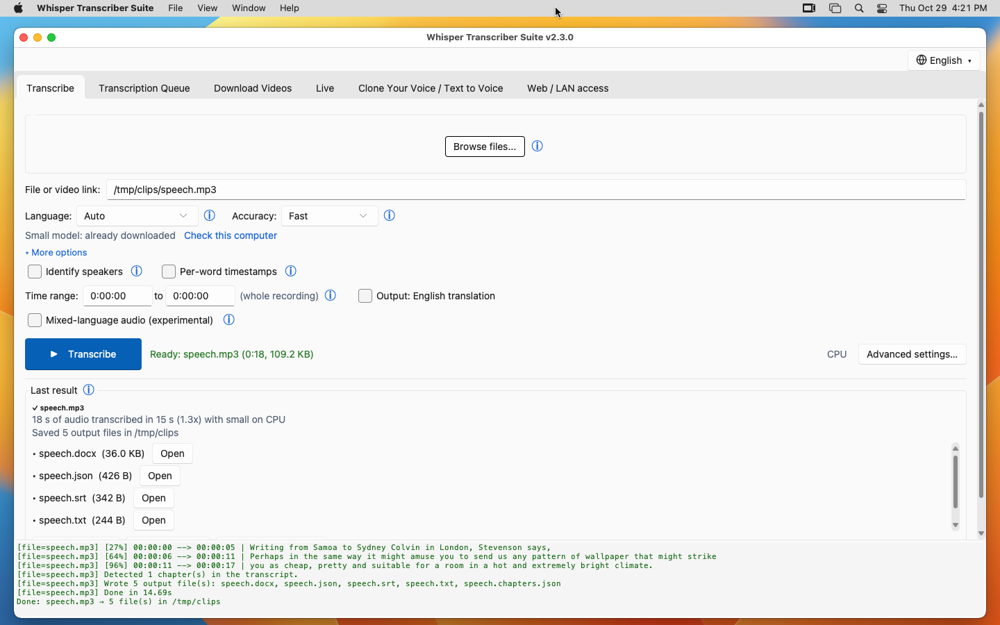

**Whisper Transcriber Suite 2.5** lets you pick an audio track, recover audio from damaged files, and undo transcript edits.

A free, open-source app that turns audio and video into text and subtitles on your computer.

[](https://github.com/Milomilo777/whisper-transcriber-suite/releases) [](https://github.com/Milomilo777/whisper-transcriber-suite/releases/tag/v2.5.0)

<p align="center"></p>

Released RELEASE_DATE.

## Download

| File | For | Size |
|---|---|---|
| [**Installer-Windows-v2.5.0.exe**](https://github.com/Milomilo777/whisper-transcriber-suite/releases/download/v2.5.0/WhisperTranscriberSuite-Installer-Windows-v2.5.0.exe) | **Windows 10 / 11.** For most people. Keeps your settings. | SIZE_INSTALLER |
| [Portable-Windows-v2.5.0.zip](https://github.com/Milomilo777/whisper-transcriber-suite/releases/download/v2.5.0/WhisperTranscriberSuite-Portable-Windows-v2.5.0.zip) | Windows. Unzip and run. | SIZE_PORTABLE |
| [v2.5.0-macOS-arm64.dmg](https://github.com/Milomilo777/whisper-transcriber-suite/releases/download/v2.5.0/WhisperTranscriberSuite-v2.5.0-macOS-arm64.dmg) | Apple-silicon Mac ¹ | SIZE_ARM64 |
| [v2.5.0-macOS-x64.dmg](https://github.com/Milomilo777/whisper-transcriber-suite/releases/download/v2.5.0/WhisperTranscriberSuite-v2.5.0-macOS-x64.dmg) | Intel Mac | SIZE_X64 |

The Intel build needs macOS 12 Monterey or later. The Apple-silicon build needs macOS 14 Sonoma or later.

> ⭐ **Enjoying it?** Click **Star** at the top of this page — it's free, takes one click, and it's how other people find the project.

## What's new in 2.5

- **Audio track choice.** Pick which track to transcribe in a file with several tracks.
- **Damaged media recovery.** Save readable audio to a temporary copy and choose whether to retry.
- **Transcript editing.** Undo or redo edits, split or join subtitles, and read or export paragraphs as text or Markdown.
- **Compare a re-run.** Try another preset, compare both transcripts side by side, and mark your preferred result.
- **AI assistants.** Use local MCP to transcribe files you allow.
- **GPU temperature limit.** Set a limit so the app can ease the load on your NVIDIA GPU as it warms up.
- **Updated downloads.** yt-dlp 2026.11.23 improves YouTube format detection.

<p align="center"></p>

<p align="center"></p>

## 🐞 BUG_COUNT bugs fixed

TOP_FIXES [Full list →](https://github.com/Milomilo777/whisper-transcriber-suite/blob/master/docs/CHANGELOG.md)

## Install in 10 seconds

- **Windows:** Run the installer. If SmartScreen warns, click **More info → Run anyway**.
- **Mac:** Quit the app. Open the dmg and drag the app to *Applications*. Choose **Replace** to upgrade. First launch: right-click → **Open** (macOS 15+: *Privacy & Security → Open Anyway*). Or paste this into Terminal:

```bash
if pgrep -x "Whisper Transcriber Suite" >/dev/null; then echo "Quit Whisper Transcriber Suite before updating."; else
  A=x64; [ "$(uname -m)" = arm64 ] && [ "$(sw_vers -productVersion | cut -d. -f1)" -ge 14 ] && A=arm64
  D="/Applications/Whisper Transcriber Suite.app"
  curl -fL -o /tmp/wts.dmg "https://github.com/Milomilo777/whisper-transcriber-suite/releases/download/v2.5.0/WhisperTranscriberSuite-v2.5.0-macOS-$A.dmg" && hdiutil attach -nobrowse -quiet -mountpoint /tmp/wts-dmg /tmp/wts.dmg && S="$(mktemp -d /Applications/.wts-update.XXXXXX)" && cp -R "/tmp/wts-dmg/Whisper Transcriber Suite.app" "$S/" && hdiutil detach -quiet /tmp/wts-dmg && rm /tmp/wts.dmg && { [ ! -e "$D" ] || { B="$(mktemp -d "$HOME/.Trash/wts-replaced.XXXXXX")" && mv "$D" "$B/"; }; } && mv "$S/Whisper Transcriber Suite.app" "$D" && rmdir "$S" && open "$D"
fi
```

- **Linux:** [one line from source](https://github.com/Milomilo777/whisper-transcriber-suite/blob/master/platform/linux/README.md).

<sub>¹ The Apple-silicon build received automated testing only. Bundled FFmpeg is GPL and its source is attached below.</sub>

## Thank you 💛

Thanks to [@Honarmand7](https://github.com/Milomilo777/whisper-transcriber-suite/issues/19) for flagging the Windows model download certificate error, fixed here. Thanks to everyone who used **Help → Report a problem**.

Found a problem? [Open an issue](https://github.com/Milomilo777/whisper-transcriber-suite/issues/new/choose) or email admin@whisper-transcriber-suite.com.

[](https://sourceforge.net/projects/whisper-transcriber-suite/files/v2.5.0/)
